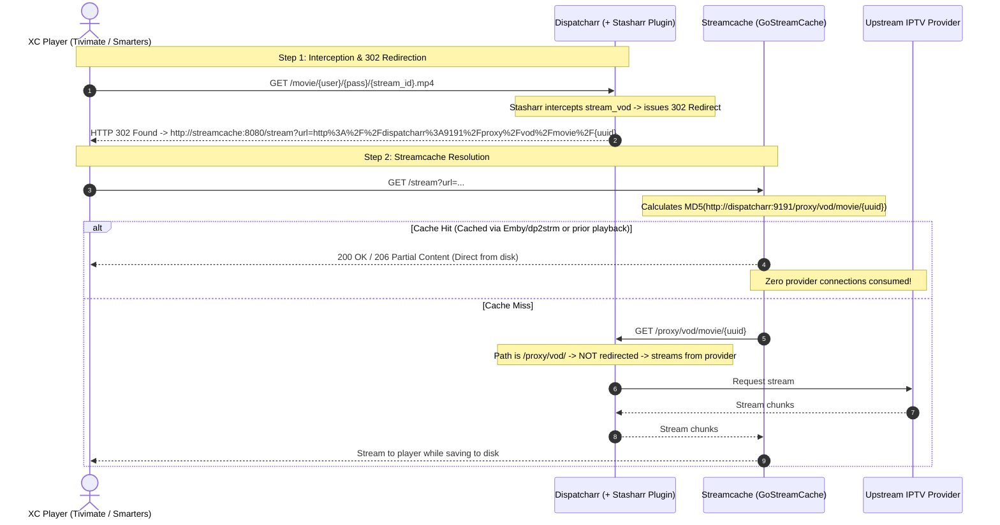

# Stasharr

**Stasharr** is a high-performance [Dispatcharr](https://github.com/Dispatcharr/Dispatcharr) plugin that transparently intercepts incoming Xtream Codes (XC) Video-on-Demand (VOD) playback requests from client players (such as Tivimate, IPTV Smarters, XCIPTV, Emby, etc.) and redirects them via **HTTP 302 Found** to [GoStreamCache (Streamcache)](https://github.com/bruor/GoStreamCache).

By redirecting clients directly to Streamcache with Dispatcharr's canonical `/proxy/vod/...` playback URL, Stasharr provides:
* **Zero Upstream Overhead on Cache Hits**: If a movie or episode is already in the cache, Dispatcharr and your upstream IPTV provider are **100% idle**.
* **100% Shared Cache with Emby (`dp2strm`)**: Content cached by Emby via [dp2strm](https://github.com/bruor/dp2strm) produces the exact same MD5 cache key in Streamcache as streams requested through Tivimate/XC players, eliminating redundant downloads.
* **Natural Loop Prevention**: End-user XC requests enter via `/movie/...` and `/series/...` (which Stasharr redirects), while Streamcache queries `/proxy/vod/...` on cache misses (which passes through to the provider without redirecting).

---

## Architecture & Stream Flow



---

## Installation

### Option A: Direct Folder Copy (Docker Compose)
1. Copy the `stasharr` directory into your Dispatcharr container's plugins directory (default: `/app/data/plugins/stasharr/`):
   ```bash
   cp -r /path/to/stasharr /your/docker/volumes/dispatcharr_data/plugins/stasharr
   ```
2. In the Dispatcharr Web UI, navigate to **Plugins**.
3. Click the **Reload** (refresh) icon to scan the plugin folder.
4. Toggle **Stasharr** to **Enabled**.

### Option B: Zip Upload via Dispatcharr Web UI
1. Create a release zip:
   ```bash
   zip -r stasharr.zip plugin.json plugin.py README.md
   ```
2. In Dispatcharr Web UI, go to **Plugins** -> **Import Plugin**.
3. Upload `stasharr.zip` and enable the plugin.

---

## Configuration Settings

Stasharr automatically renders a configuration interface in the Dispatcharr web UI under **Plugins -> Stasharr**:

| Setting | Type | Default | Description |
| :--- | :--- | :--- | :--- |
| **Enable Stasharr Interceptor** | `boolean` | `true` | Master toggle to enable or disable XC VOD redirection. Disabling immediately restores standard Dispatcharr playback without container restarts. |
| **Streamcache Base URL** | `string` | `http://streamcache:8080` | The address where Streamcache is reachable by client media players (e.g. `https://streamcache.domain.ca` or `http://192.168.1.50:8080`). |
| **Dispatcharr Base URL for Streamcache** | `string` | `http://dispatcharr:9191` | The address of Dispatcharr as reachable by Streamcache (e.g. `http://dispatcharr:9191` or `https://dp.domain.ca`). Must match `DISPATCHARR_STREAM_URL` in `dp2strm` for shared MD5 cache keys. |
| **Bypass Header Name** | `string` | `X-Streamcache-Bypass` | HTTP request header that disables redirection if present (secondary loop safety mechanism). |

---

## Administrative Actions

From the Stasharr plugin card in the Dispatcharr UI, two diagnostic actions are available:
* **Check Status**: Verifies that runtime method wrapping is active, checks database enablement, and displays current configuration.
* **Ping Streamcache**: Sends an HTTP probe from Dispatcharr to the configured `Streamcache Base URL` to verify network connectivity.

---

## Running Automated Tests

Stasharr includes a standalone unit test suite that verifies hook injection, URL formatting, cache key compatibility with GoStreamCache, loop avoidance, and fallback error handling:

```bash
python3 -m unittest discover -s tests -v
```

---

## License

MIT
