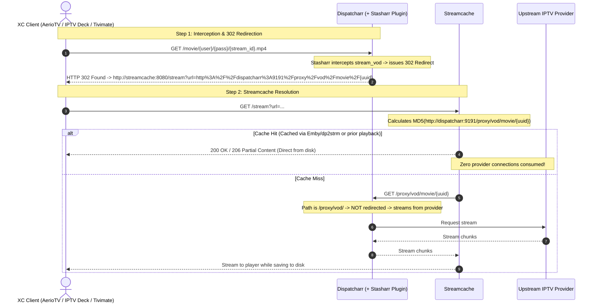

# Stasharr

**Stasharr** is a high-performance [Dispatcharr](https://github.com/Dispatcharr/Dispatcharr) plugin that transparently intercepts incoming Xtream Codes (XC) Video-on-Demand (VOD) playback requests from XC clients (such as AerioTV, IPTV Deck, Tivimate, etc.) and redirects them via **HTTP 302 Found** to [Streamcache](https://github.com/bruor/streamcache).

By redirecting clients directly to Streamcache with Dispatcharr's canonical `/proxy/vod/...` playback URL, Stasharr provides:
* **Zero Upstream Overhead on Cache Hits**: If a movie or episode is already in the cache, Dispatcharr and your upstream IPTV provider are **100% idle**.
* **100% Shared Cache with Emby (`dp2strm`)**: Content cached by Emby via [dp2strm](https://github.com/bruor/dp2strm) produces the exact same MD5 cache key in Streamcache as streams requested through XC clients (AerioTV, IPTV Deck, Tivimate), eliminating redundant downloads.
* **Natural Loop Prevention**: End-user XC requests enter via `/movie/...` and `/series/...` (which Stasharr redirects), while Streamcache queries `/proxy/vod/...` on cache misses (which passes through to the provider without redirecting).

---

## Architecture & Stream Flow



---

## Installation

1. Copy the `stasharr` directory into your Dispatcharr container's plugins directory (default: `/app/data/plugins/stasharr/`):
   ```bash
   cp -r /path/to/stasharr /your/docker/volumes/dispatcharr_data/plugins/stasharr
   ```
2. In the Dispatcharr Web UI, navigate to **Plugins**.
3. Click the **Reload** (refresh) icon to scan the plugin folder.
4. Toggle **Stasharr** to **Enabled**.

---

## Configuration Settings

Stasharr automatically renders a configuration interface in the Dispatcharr web UI under **Plugins -> Stasharr**:

| Setting | Type | Default | Description |
| :--- | :--- | :--- | :--- |
| **Enable Stasharr Interceptor** | `boolean` | `true` | Master switch to enable or disable XC VOD redirection to Streamcache. Disabling immediately restores standard Dispatcharr playback without container restarts. |
| **Streamcache Base URL** | `string` | `http://streamcache:8080` | The publicly accessible Streamcache endpoint that XC clients will be redirected to (e.g., `https://streamcache.yourdomain.ca`). |
| **Dispatcharr Base URL** | `string` | `http://dispatcharr:9191` | The canonical Dispatcharr base URL passed inside the target `?url=` parameter that Streamcache uses to fetch media via `/proxy/vod/...` on cache misses. Setting this explicitly to match `dp2strm` ensures all requests use identical pathing and produce identical MD5 cache keys regardless of how a client connected. |

---

## 🔒 Security & Streamcache Hardening

If your XC clients connect to Streamcache over the public internet (WAN), make sure to harden your Streamcache deployment:

### 1. Restrict Upstream Hosts in Streamcache (`ALLOWED_HOSTS`)
Streamcache fetches media from the target URL provided in the `?url=` query parameter. To prevent your instance from acting as an open proxy or SSRF vector, configure `ALLOWED_HOSTS` in your Streamcache environment to **only** allow your Dispatcharr instance:
```bash
ALLOWED_HOSTS="dispatcharr:9191,dp.yourdomain.ca"
```
Any request attempting to stream from an unapproved upstream host will immediately be rejected with `403 Forbidden Host`.

### 2. Lock Down Sensitive Endpoints at the Reverse Proxy
Streamcache serves both playback routes and internal administrative/debug endpoints on the same port. At your reverse proxy (Traefik, Nginx, Caddy, etc.), **only expose the playback endpoints to the WAN**:

* **Expose to WAN**:
  * `/stream` (and `/u/*` if base64 routes are used)
* **Restrict to LAN / VPN only**:
  * `/` (Web Dashboard)
  * `/dashboard/*` (Live SSE metrics)
  * `/api/*` (Download hydration controls)
  * `/debug/*` (Go runtime diagnostics and pprof profiling)

---

## Administrative Actions

From the Stasharr plugin card in the Dispatcharr UI, two diagnostic actions are available:
* **Check Status**: Verifies that runtime method wrapping is active, checks database enablement, and displays current configuration.
* **Ping Streamcache**: Sends an HTTP probe from Dispatcharr to the configured `Streamcache Base URL` to verify network connectivity.

---

## Running Automated Tests

Stasharr includes a standalone unit test suite that verifies hook injection, URL formatting, cache key compatibility with Streamcache, loop avoidance, and fallback error handling:

```bash
python3 -m unittest discover -s tests -v
```

---

## License

MIT
